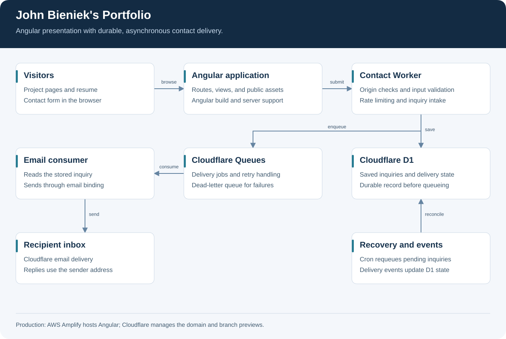

# Architecture

Angular presentation with durable, asynchronous contact delivery.

Production: AWS Amplify hosts Angular; Cloudflare manages the domain and branch previews.

## Implementation references

- [src/app](../src/app)
- [angular.json](../angular.json)
- [contact-worker/src/index.ts](../contact-worker/src/index.ts)
- [contact-worker/wrangler.jsonc](../contact-worker/wrangler.jsonc)

## Project overview

[Portfolio project page](https://johnbieniek.com/projects/angular-portfolio)
